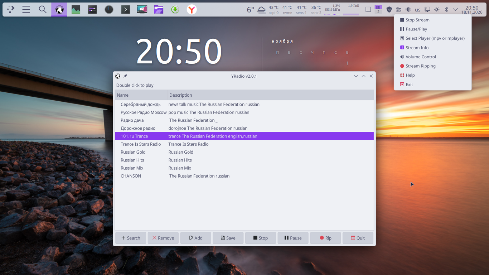

# YRadio-X11-Wayland

- 2026-11-18 v2.0.1, native Wayland support: no X11-only parts any more.
- (no yad --plug/--paned, no xdotool, no xmessage).
- GUI is now one normal window (station list); search/load is a dialog, 'now playing' is a desktop notification.
- The display of the icon on the taskbar has been fixed.
- The number of buttons on the bottom panel has been reduced.
- The (Help) button has been moved to the tray icon.
- The YRadio tray icon now changes color to match the theme, and the program name appears when you hover over the icon.
- An icon has been added to the pop-up notification.
- Dependencies: mpv, yad, alsa-utils , pulseaudio-utils

## Author
Rewritten script YRadio , radio player by author's $${\color{red}\mathbf{@Fredx181}}$$ ► [YRadio Internet Radio Player](https://forum.puppylinux.com/viewtopic.php?t=8273)

