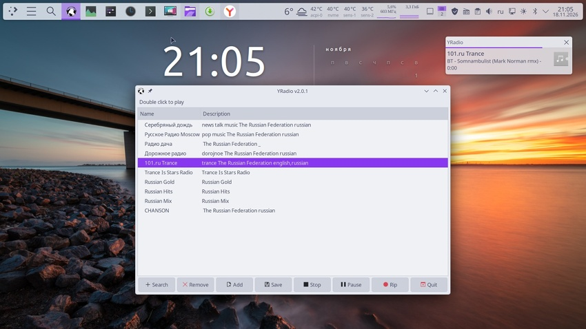

# YRadio-X11-Wayland

- 2026-11-15 v1.9.9, native Wayland support: no X11-only parts any more.
- (no yad --plug/--paned, no xdotool, no xmessage).
- GUI is now one normal window (station list); search/load is a dialog, 'now playing' is a desktop notification.
- The display of the icon on the taskbar has been fixed.
- The number of buttons on the bottom panel has been reduced.
- The (Help) button has been moved to the tray icon.
- Dependencies: mpv, yad

#### Rewritten script YRadio , radio player by author's `@fredx181` [YRadio](https://forum.puppylinux.com/viewtopic.php?t=8273)
